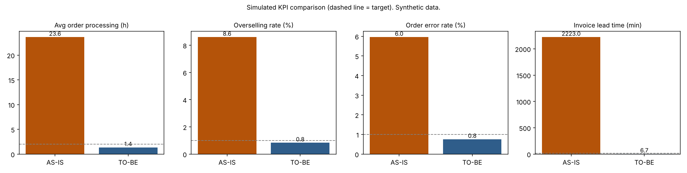

# Order-to-Cash (O2C) & Inventory Automation: Business Analysis Case Study

> **Self-initiated case study for a simulated client.** PT Maju Distribusi Nusantara is fictional. All baseline figures and KPI results are simulated to demonstrate the analysis method; they are not real business results.

**Role:** Business Analyst / System Analyst (Alief Sukma Dewanta)
**Duration:** Nov 2026 | **Solution platform:** Odoo ERP | **Methodology:** Hybrid (Waterfall documentation, 2-week Agile sprints)

---

## 1. Business Problem

A B2B FMCG distributor serving about 350 retail stores takes orders by WhatsApp, checks stock in an Excel file updated once a day, and issues invoices by hand. The result:

- Orders are mistyped or lost (about 6% error rate, simulated baseline)
- Items are sold that are not in stock (about 9% of orders)
- Invoices are issued 1 to 2 days after delivery
- No audit trail and no reorder trigger, so stockouts are noticed late

## 2. Objectives and Success Metrics

| ID | Objective | Metric | Target |
|---|---|---|---|
| BO-01 | Faster order processing | Confirmation to pick instruction | Under 2 hours (from about 24) |
| BO-02 | Eliminate overselling | Orders confirmed without enough stock | Under 1% |
| BO-03 | Accurate stock | System vs physical count | At least 98% |
| BO-04 | Faster invoicing | Shipment to invoice sent | Under 15 minutes |
| BO-05 | Fewer order errors | Orders needing manual correction | Under 1% |
| BO-06 | Proactive replenishment | Stockouts per month | 70% fewer |

## 3. Approach

1. **Elicit and model:** stakeholder map, AS-IS and TO-BE BPMN, 10 business rules
2. **Specify:** BRD and FSD with 46 functional requirements (MoSCoW) and 7 non-functional requirements
3. **Plan the backlog:** 7 epics, 17 user stories with Gherkin acceptance criteria, 5 sprints (100 story points)
4. **Design:** 25-table ERD with stock reservation, optimistic locking, immutable audit log
5. **Verify:** 62 test cases, requirements traceability matrix, 9 end-to-end UAT scenarios, defect log
6. **Prove:** Odoo configuration, demo video, simulated KPI dashboard (Python, Apache Superset)

## 4. Key Artifacts

| Area | Artifact | Link |
|---|---|---|
| Requirements | BRD and FSD (includes user stories, ERD, QA, UAT) | `01_Requirements/BRD_FSD.pdf` |
| Requirements | Requirements workbook (46 FRs, 10 rules, 17 stories) | `01_Requirements/Requirements_Workbook.xlsx` |
| Requirements | Backlog items closing traceability gaps | `01_Requirements/backlog_items.md` |
| Design | AS-IS BPMN | `02_Design/BPMN_AS-IS.png` |
| Design | TO-BE BPMN | `02_Design/BPMN_TO-BE.png` |
| Design | ERD (25 tables) and editable DBML | `02_Design/ERD.png`, `02_Design/ERD.dbml` |
| Design | Wireframes | `02_Design/wireframes_figma_link.md` |
| Testing | RTM, 62 test cases, UAT scenarios, defect log, execution summary | `03_Testing/Test_Management_Workbook.xlsx` |
| Project management | Sprint plan, RACI, Jira import file | `04_Project_Mgmt/` |
| Solution | Odoo configuration notes and screenshots | `05_Solution/` |
| Solution | Demo video (4 min) | `05_Solution/demo_video_link.md` |
| Data | Simulation script, data set, KPI charts | `06_Data/` |

## 5. Solution Highlights

- **No overselling.** Available stock is derived as On Hand minus Reserved. Confirming an order reserves stock atomically; when two users confirm the last units at the same time, one succeeds and the other is rejected.
- **Controlled exceptions.** Orders above IDR 50,000,000, discounts above 10%, and credit-limit breaches route to the Sales Manager.
- **Invoice at shipment.** Invoices are generated from shipments, so partial shipments create partial invoices. Sent invoices are locked and corrected only through credit notes.
- **Proactive purchasing.** Low available stock creates a draft purchase request through reordering rules.
- **Traceability.** Every one of the 46 requirements maps to a user story or backlog item and at least one test case. Building the matrix exposed 6 requirements without a story, which were added as backlog items.

## 6. Results (simulated)

Generated by `06_Data/generate_data.py` (seed 42, 5,000 orders simulated under both scenarios). The parameters are assumptions chosen to illustrate the KPI method; they are **not** measurements from a real company.

| KPI | AS-IS (simulated) | TO-BE (simulated) | Target |
|---|---|---|---|
| Avg. order processing time | 23.6 h | 1.4 h | Under 2 h |
| Overselling rate | 8.6% | 0.8% | Under 1% |
| Order error rate | 6.0% | 0.8% | Under 1% |
| Avg. invoice lead time | 37.1 h | 6.7 min | Under 15 min |



Interactive dashboard: `06_Data/o2c_dashboard.html` (open in a browser, or publish with GitHub Pages and link it here).

## 7. Testing Summary

| Cycle | Planned | Passed | Failed | Open Critical/High |
|---|---|---|---|---|
| System test | 62 | | | |
| UAT | 9 scenarios | | | |

## 8. Lessons Learned

Complete after execution. Suggested points: which requirement changed most during test design, which edge case was the hardest to specify, and what you would validate with real stakeholders (real baseline measurement, pilot with one sales team, change management for sales reps used to WhatsApp).

## 9. Tools

Visual Paradigm, Figma, Jira, Odoo, Python (pandas), Apache Superset, Excel.

## 10. Repository Structure

```text
01_Requirements/   BRD_FSD.pdf, Requirements_Workbook.xlsx, backlog_items.md
02_Design/         BPMN_AS-IS, BPMN_TO-BE, ERD (svg and png), ERD.dbml, wireframes_figma_link.md
03_Testing/        Test_Management_Workbook.xlsx
04_Project_Mgmt/   sprint_plan_and_raci.md, jira_import.csv
05_Solution/       odoo_configuration_notes.md, demo_script.md
06_Data/           generate_data.py, o2c_simulated_orders.csv, kpi_summary.csv, kpi_comparison.png, o2c_dashboard.html
```

## Contact

Alief Sukma Dewanta | aliefsd84@gmail.com | [LinkedIn](https://linkedin.com/in/aliefsd84) | [Portfolio](https://yaboialip.github.io/My-portfolio)
